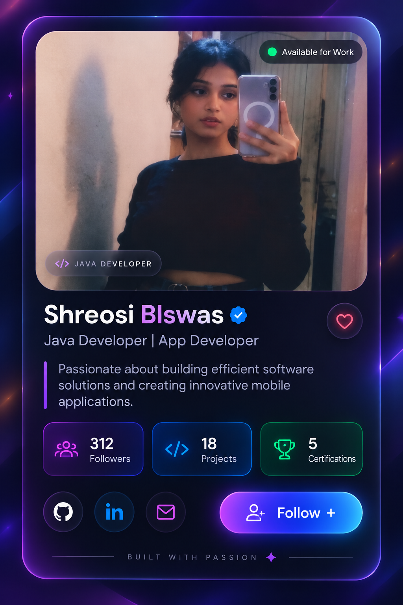

# ✨ Neon Glassmorphism Developer Profile Card

A modern, responsive developer profile card built using **HTML, CSS, and JavaScript**. Featuring a premium dark theme, vibrant neon gradients, glassmorphism effects, and interactive buttons.

## 🖼️ Preview


<p align="center">
  
</p>


## ✨ Features

- 🎨 Premium neon purple and blue gradient design
- 💎 Glassmorphism-inspired styling and glowing borders
- 📱 Responsive layout for desktop, tablet, and mobile
- 🖼️ Custom profile photo with floating badges
- 💜 Interactive Like and Follow buttons
- 📊 Stylish statistics for followers, projects, and certifications
- 🔗 Social media links for GitHub, LinkedIn, and email
- ⚡ Smooth hover effects and entrance animations
- ♿ Reduced-motion accessibility support

## 🛠️ Technologies Used

- **HTML5** — Semantic page structure
- **CSS3** — Grid, gradients, animations, responsive design
- **JavaScript** — Interactive Like and Follow buttons
- **Lucide Icons** — Clean, modern icons
- **Google Fonts** — Inter typography

## 🚀 Getting Started

1. Clone the repository:

   ```bash
   git clone git@github-account2:shreosibiswas835/profile-ui-card.git
   ```

2. Open the project folder:

   ```bash
   cd profile-ui-card
   ```

3. Open `index.html` in your browser, or use the **Live Server** extension in VS Code.

No build tools or package installation are required.

## 📁 Project Structure

```text
profile-ui-card/
├── index.html
├── style.css
├── script.js
├── profile.jpg
├── screenshots/
│   └── profile-card.png
├── README.md
├── .gitignore
└── LICENSE
```

## 🎨 Customization

- Replace `profile.jpg` with your preferred profile photo.
- Update your name, role, bio, and statistics in `index.html`.
- Change colors, spacing, and effects in `style.css`.
- Add your actual social profile URLs and email address.
- Update the sample statistics to reflect your real achievements.

## ⚠️ Note

The Follow and Like buttons demonstrate front-end interactions only. Follower counts are updated locally and are not connected to a backend or social media service.

## 👩‍💻 Author

**Shreosi Biswas**

Java Developer | App Developer

## 📄 License

This project is licensed under the MIT License. See the [LICENSE](LICENSE) file for details.

---

⭐ If you like this project, consider giving the repository a star!
